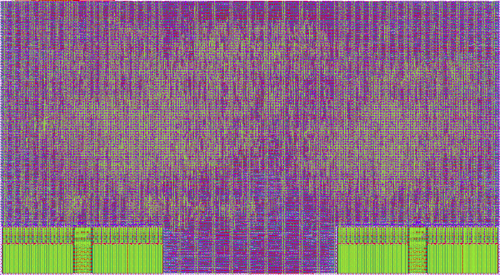

# Wirelingo: a programmable protocol emulator ASIC

*(Formerly protoemu; code identifiers such as the Tiny Tapeout module
`tt_um_josusanmartin_protoemu` and `tools/micropython/protoemu.py` keep the old
name until the next re-harden.)*

An entry for the [Jane Street protocol emulator ASIC competition](https://blog.janestreet.com/protocol-emulator-asic-competition/),
on IHP SG13CMOS5L through Tiny Tapeout (6x4 tiles). It has not been
fabricated. Every result here names its evidence level: model, RTL
simulation, formal, gate level, or RTL in FPGA fabric. FPGA is not silicon.

**Short on time:** read the [two-page summary](docs/summary.md). Reviewers:
[docs/guide.md](docs/guide.md) maps each claim to its evidence and the
command that reproduces it. New to hardware:
[docs/explain-wirelingo.md](docs/explain-wirelingo.md). The normative spec is
[docs/isa.md](docs/isa.md).



*The signed-off layout, run fo6, rendered from its GDS (sha256 `e67697034da6cd34…`,
[docs/physical.md](docs/physical.md)) with KLayout and the IHP layer colours.
The two instruction SRAMs are the blocks at the bottom corners; standard-cell
logic fills the rest.*

## What it is

Protocols are programs, not peripherals. The chip has **two small cores built
for bit-banging**, each with its own SRAM bank of 256 32-bit instructions,
8-word FIFOs to the host, a fractional clock divider, registers with an ALU
and a CRC tap. Beside core 0 sits a **line unit**, a configurable line coder.
A host (the Tiny Tapeout demo board's RP2350) loads firmware over SPI, 1-bit
or quad, and exchanges data through the FIFOs. The instruction set starts
from the RP2040's PIO and adds what real protocols kept asking for
([below](#what-wed-do-differently-from-pio)).

It was designed by one person with no prior chip-design experience, with AI
agents writing the spec, RTL, firmware and tests, and claims checked against
evidence an agent can't talk its way past
([docs/methodology.md](docs/methodology.md)).

## What it does after fabrication

No protocol is fixed in the silicon. The cores run firmware, and the line
unit's settings are chosen by the host when it loads a program.

* **Protocols are firmware.** UART, SPI, I2C, CAN, USB at low and full speed,
  10BASE-T, JTAG, 1-Wire, PS/2, WS2812 and the rest are the 68 firmware files
  in [`firmware/`](firmware/), assembled on a PC ([docs/asm.md](docs/asm.md))
  and loaded over SPI. A new protocol is a new program.
* **The line unit is a fixed menu that software picks from.** It offers
  NRZ, NRZI or Manchester coding, bit stuffing after K equal bits or K ones,
  a choice of frame endings (release, SE0, high, hold) and receive clock
  recovery. The menu was built
  with USB and 10BASE-T in mind, and CAN-style stuffing also fits; software
  chooses from it but cannot add a coding. The host picks with three register
  writes (LINECFG, LINEDIV, LINEPINS) when it loads a program
  ([docs/isa.md §4.7](docs/isa.md#47-line-unit-core-0)). Two protocols use it.
  Full-speed USB runs at 4 clocks per bit at 48 MHz, and the pure-firmware
  receiver (`usb_ls_rx`, the low-speed one) takes at least 13 instructions
  per bit, so it cannot keep up. For 10BASE-T receive, what the unit adds is
  the rate and the jitter tolerance, not the coding: firmware alone decodes
  Manchester at slow rates (`rc5_rx` and `dali_ctrl`, at about 0.56 and
  1.2 kbit/s). The unit samples the pin at both clock edges and tracks the
  sender's phase, while a core sees one sample per clock; that is the
  mechanism, not a measured comparison, since no 10BASE-T receiver in
  firmware alone has been written. Low-speed USB runs either way (two cores without
  it, one with it).
* **Rehearsed with the chip frozen.** With the chip's Verilog frozen at tag
  `rc-93c2137-t48ba` (unchanged since), three rounds of protocols it was not
  designed for were added in firmware only: DMX512, LIN, NEC and RC-5
  infrared, I2S, Wiegand, DShot600 (also bidirectional), DALI, Modbus RTU,
  MIDI, a quadrature encoder counter, HDMI-CEC, ISO 7816-3 T=0 and SMBus with
  PEC, 21 programs. Their 16 RTL tests also pass on the signed-off gate-level
  netlist, and all three rounds ran on the RTL in FPGA fabric
  ([docs/post-freeze-protocols.md](docs/post-freeze-protocols.md)). A fresh
  agent later added HD44780 and a subset of ATA PIO the same way
  ([docs/blind-test.md](docs/blind-test.md)).

The line-unit settings that tests exercise
([docs/line-unit-settings.md](docs/line-unit-settings.md) cites the firmware
and tests for each):

| LINECFG | Coding | Used by |
|---|---|---|
| `0x49F3` | NRZI, a stuffed 0 after six 1s, differential pair, SE0 end of packet | USB low and full speed: `usb_ls_dev`, `usb_fs_dev`, `usb_enum`, the UART-to-USB pairs |
| `0x4005` | Manchester, receive only | 10BASE-T receive: `eth10_rx`, `eth10_match` |
| `0x4E85` | Manchester both ways, differential, 3 bits high at the end (TP_IDL) | 10BASE-T receive and reply on one core: `eth10_reply` |
| `0x6029` | NRZ, one opposite bit after five equal bits | CAN-style framing, in a model test only; `can_tx` and `can_rx` stuff bits in core code instead |

## What runs on it, and how far each is proven

Columns: **M** model (cycle-accurate, lockstep-checked against the RTL),
**R** RTL simulation through the real SPI host port, **G** gate level on
fo6's signed-off netlist, **F** RTL in FPGA fabric (Kria KV260) against the
other core, a pattern generator or, where it says so, Linux. A **\*** means
that level was reached by an earlier version of that firmware, and the
current one needs a rerun there. "Suppl." marks a gate-level run outside the
release gate. No column is silicon. A blank means no test at that level. The
[full firmware table](#what-runs-on-it) gives each program's limits.

| Protocol | Firmware | M | R | G | F |
|---|---|---|---|---|---|
| UART 8N1 | `uart_tx`, `uart_rx` | yes | yes | yes (`uart_rx`\*) | yes (`uart_rx`\*) |
| SPI master: modes 0-3, packed, 4 clocks per SCK | `spi_master`, `spi_master_modes`, `spi_master_packed`, `spi_master_fast` | yes | `spi_master`, `spi_master_packed`, `spi_master_fast` (modes 1-3: model and FPGA only) | `spi_master`, `spi_master_fast`; `spi_master_packed` suppl. | yes |
| I2C master, target, sniffer | `i2c_master`, `i2c_device`, `i2c_sniff` | yes | master, target | master\*, target | yes (master\*) |
| Logic analyzer, then an I2C target cloning the captured device | `la_capture` + `i2c_device` | yes | yes | yes | yes |
| USB low speed, two cores, no line unit | `usb_ls_rx` + `usb_ls_tx` | yes | yes | yes (`usb_ls_tx`\*) | |
| USB low speed, one core and the line unit | `usb_ls_dev` | yes | yes | yes\* | yes\* |
| USB full speed (12 Mbit/s), one core and the line unit | `usb_fs_dev` | yes | yes | yes\* | yes\*, also with Linux |
| USB device that enumerates by itself | `usb_enum` | yes | yes | yes\*, also with SDF | yes\*, also with Linux |
| 10BASE-T transmit, receive | `eth10_tx`, `eth10_rx` | yes | yes | yes | yes |
| 10BASE-T with carrier sense; ARP, ping and UDP echo with the host's stack | `eth10_tx_cs` + `eth10_rx` | yes | yes | yes | yes, one frame at a time, also with Linux |
| 10BASE-T cut-through match; match and reply with no host | `eth10_match`, `eth10_reply` | yes | `eth10_reply` | | `eth10_match` |
| CAN 2.0A | `can_tx`, `can_rx` | yes | | | yes (`can_rx`\*) |
| JTAG, 1-Wire, PS/2 device, WS2812 | `jtag`, `onewire`, `ps2_device`, `ws2812` | yes | | | yes |
| Post-freeze: DMX512, LIN, NEC, I2S, Wiegand, DShot600, DALI, Modbus RTU, MIDI, quadrature encoder, HDMI-CEC, ISO 7816-3, SMBus, RC-5 | 21 programs | yes | yes | yes, also with SDF | yes |
| MDIO, a QSFP-style module map, PMBus | `mdio_master`, `mdio_phy`, `i2c_device`, `smbus_host` | yes | yes | | |
| Pulse timestamps | `pps_capture` | yes | yes | | |
| UART to a PC over USB | `usb_uart_*`, four variants | yes | three of four | the same three, suppl. | |
| HD44780 4-bit, ATA PIO subset (blind test) | `hd44780_4bit`, `ata_pio` | yes | yes | | |
| SWD probe (parked) | `swd_probe` | yes | | | |

The release gate's gate-level runs used software `7685aba`. The post-freeze,
network-stack and host-workflow runs on the same netlist are supplementary
receipts outside the gate; the host-workflow ones (`test_usb_uart_rtl` 3/3,
`test_spi_packed_host` 1/1, functional, validation `61af9b2`) are in
[docs/release-evidence.md](docs/release-evidence.md). The post-freeze SDF runs
pass at the typical corner, and at the slow and fast corners in supplementary
single-case runs. The FPGA runs against
Linux: USB in [fpga/kv260](fpga/kv260/README.md#result-against-linux-low-speed-2026-10-30)
and [evidence/kv260-usb-20261030](evidence/kv260-usb-20261030/README.md); the
network stack in
[evidence/fabric-ping-20261103](evidence/fabric-ping-20261103/README.md).

## How it is verified

| Method | What it checks | Level | Evidence |
|---|---|---|---|
| Two implementations, compared every cycle | A Python cycle model and the RTL on random programs, pins and host traffic, with required coverage goals | RTL simulation | [docs/verification.md](docs/verification.md) |
| A third implementation | A Hardcaml and OCaml port whose generated Verilog is proved equal to the RTL | Formal, simulation | [docs/hardcaml-port.md](docs/hardcaml-port.md) |
| Formal proofs | FIFOs (with join), the host port against a pin-level reference, core invariants, line-unit bounds | Formal | [docs/verification.md](docs/verification.md), [docs/formal-hostport.md](docs/formal-hostport.md) |
| Mutation testing | 34 of 34 mutants killed (recorded 2026-10-05) | Model, RTL | [docs/verification.md](docs/verification.md) |
| Netlist equivalence | fo6's netlist equals the RTL: 7429 of 7429 points, two engines, 5 of 5 planted netlist bugs caught | Formal, on the netlist | [docs/equivalence.md](docs/equivalence.md) |
| Gate-level simulation | All 29 top-level tests on fo6's netlist; SDF delays at typ, slow and fast, with an overclocked control that must fail | Gate level | [docs/release-evidence.md](docs/release-evidence.md) |
| Outside oracles | sigrok's protocol decoders; Linux's USB and network stacks on the FPGA build | RTL simulation, FPGA | [docs/post-freeze-protocols.md](docs/post-freeze-protocols.md), [fpga/kv260](fpga/kv260/README.md) |
| Fault injection | Seeded wire faults: six real failures found, four fixed | Model, RTL | [docs/fault-testing.md](docs/fault-testing.md) |
| Blind test | Two protocols drawn by a rule, chip and tools frozen | Model, RTL | [docs/blind-test.md](docs/blind-test.md) |
| Independent verifier agent | Reruns and attacks the claims of each item sent to it: reports 000-050, 27 PASS and 24 FAIL, kept verbatim | Review | [evidence/verifier](evidence/verifier/README.md) |
| Lean proofs | Manual proofs and finite comparisons against the RTL, each with its stated scope | Formal | [docs/lean-verification.md](docs/lean-verification.md) |

What is proven at each level, and what is still open:
[docs/status.md](docs/status.md) and
[docs/verification-story.md](docs/verification-story.md). Raw records are in
[evidence/](evidence/README.md). The release receipts' archive
(`wirelingo-release-evidence-7685aba-fo6.tar.gz`, sha256 `868c5d3a…`) is not
in git; it is to be attached as a release asset.

## Physical status (run fo6)

* **Signoff passes with no waiver** (`flow/signoff.py`, and the stricter
  `flow/release_check.py`): 0 routing violations, 0 KLayout DRC, LVS clean,
  0 antenna violations, and no slew, capacitance or fanout violation at any
  corner. Tiny Tapeout's precheck passes on the GDS
  ([docs/physical.md](docs/physical.md),
  [docs/release-evidence.md](docs/release-evidence.md)).
* **Clock: the demos run at 48 MHz, with margin; 50 MHz is met at signoff**
  at all three corners. The worst flop or SRAM setup slack at the slow corner
  is +0.010 ns at 20 ns; hold slack is +0.19 / +0.36 / +0.095 ns at typ /
  slow / fast. The 48 MHz margin is derived, not measured on fo6: the clock
  period is 0.833 ns longer, and in every run of
  [physical.md](docs/physical.md)'s settings table that has STA at both
  clocks, the 48 MHz slack is the 50 MHz slack plus 0.833 ns. Full-speed USB
  needs exactly 48 MHz. 10BASE-T receive meets 802.3's ±13.5 ns edge jitter
  at 50 MHz (where the slack is +0.010 ns); at the demo board's 40 MHz it
  tolerates ±12 ns in a one-off model sweep
  ([docs/guide.md](docs/guide.md#known-limits)).
* The netlist is formally equivalent to the RTL and passes all 29 top-level
  tests at gate level (software `7685aba`). A clean checkout rebuilt on a
  4-CPU machine reproduces the netlist bit for bit.
* Not yet measured: anything through the real pads, including the host
  port's speed from the demo board. Analogue behaviour is not simulated.

## Try it

```
python3 -m venv .venv && .venv/bin/pip install -r test/requirements.txt
export PATH=$HOME/tools/oss-cad-suite/bin:$PWD/.venv/bin:$PATH   # iverilog, yosys, sby
PYTHONPATH=tools .venv/bin/python -m pytest test/model/test_line.py test/model/test_usb_fs.py   # on the model
cd test && make                                                  # top level through the SPI port (RTL)
```

To write a protocol: [docs/asm.md](docs/asm.md) (assembler),
[docs/isa.md](docs/isa.md) (instructions), and any file in `firmware/` as an
example. On the demo board, copy the MicroPython driver and run
`bringup.uart_loopback(pe)`, which needs no wiring
([docs/info.md](docs/info.md#how-to-test)).

---

# In detail

The rest of this page is the full reference: the instruction-set additions,
the firmware table with each program's limits and exact evidence, optional
host workflows, verification, physical design and the repository layout.

## What we'd do differently from PIO

The ISA starts from the RP2040's PIO and adds what real protocols kept asking
for:

- **Room for real programs:** 256 instructions per core, in its own bank (PIO: 32
  shared).
- **Registers and arithmetic:** 16-bit R0–R3, a 16-bit immediate load, an ALU
  with Z/C flags.
- **WAITs that can't hang and don't miss edges:** any WAIT can time out; it can
  wait on a rise, fall or any edge, caught at full clock resolution even when
  the core ticks slowly; and it can be qualified by a second pin ("SDA falls
  while SCL is high" is one instruction). v2: or wait until any of 8 pins
  differs from a register, with the timeout counter as the timestamp.
- **Pins:** per-pin open drain, `PIN p, hi/lo/toggle/hiz` on any pin, 8 virtual
  pins as wires between cores, per-pin ownership.
- **A CRC tap** (any polynomial up to 16 bits) fed by the shift registers, and
  **FIFO join** (RXF as a second TX stage) for line rates above what the SPI
  host port can stream.
- **A line unit** beside core 0: NRZI, bit stuffing, end-of-packet detection
  and Manchester decoding with a phase-tracking loop, so one core runs a whole
  USB device, low or full speed, and 10BASE-T receive meets 802.3's ±13.5 ns
  edge jitter.
- **A host link that keeps up:** quad SPI at SCK = clk, 193 Mbit/s of payload
  in RTL simulation and 193.6 Mbit/s on the FPGA, against its fabric SPI
  master on the same clock; not yet measured through the pads or from the
  demo board.

**Reviewers:** [docs/guide.md](docs/guide.md) maps each claim to its evidence
and the command that reproduces it.

[docs/isa.md](docs/isa.md) is the normative spec. The RTL, the golden model
and the assembler implement it, and are checked against each other
([docs/verification.md](docs/verification.md)).

## What runs on it

Each program talks to an independent device model that sees only the pins.
"RTL" = loaded and exercised through the real SPI host port on the RTL; the
main suite (`test/test.py`) also passes on the signed-off gate-level netlist.
"GL" = the post-freeze module (`test_post_freeze`, 16 tests) passes on that
netlist too (fo6, functional, 2026-10-14). With SDF delays at the typical
corner all 16 pass: 14 in the first run; `pf_dmx512` and `pf_wiegand`
failed only on exact-equality timing assertions (pad rise and fall delays
differ by 50–170 ps) and pass after a 1 ns tolerance (commit 8dd249a):
[docs/post-freeze-protocols.md](docs/post-freeze-protocols.md).
The host-workflow modules (`test_usb_uart_rtl`, `test_spi_packed_host`, `test_spi_preloaded_host`, `test_uart_capture_host`) pass on the RTL and, functionally, on fo6's gate-level netlist ([release evidence](docs/release-evidence.md)).
"Model" = on the cycle-accurate model, which is lockstep-checked against the RTL. "KV260" =
the RTL built for the Kria KV260 FPGA, against the other core or the FPGA's
pattern generator ([fpga/kv260](fpga/kv260/README.md)).

| Firmware | What it does | Limits | Verified on |
|---|---|---|---|
| `uart_tx`, `uart_rx` | 8N1, 8 ticks per bit (fractional divider) | RX tolerates a ±3 % sender, back to back; F0 on a framing error; RX drops a start bit that is high again at mid-bit (a glitch) | RTL; ±3 % and back-to-back on the model. The mid-bit check, added by `fault-fixes`, is verified on the model and in RTL simulation only (`test_uart_rx_glitch`); the gate-level receipts and the KV260 runs (loopback and real PMOD pins) used `uart_rx` from before it, and neither has been rerun |
| `spi_master` | mode 0, MSB first, 8-bit frames, f_SCK = f_tick / 4 | chip select by the host or a wrapper | RTL; KV260 against pe_lab's SPI device (DELAY sweeps at CLKDIV 1-3) |
| `spi_master_modes` | modes 0-3 (CPOL by a define, CPHA by program block), MSB first, 8-bit full-duplex frames, compact and unrolled forms | chip select by the host or a wrapper; in mode 3 at CLKDIV 3 MISO is read 4 clocks after the launching fall: on the KV260 a MISO delay up to 77.5 ns was read right and a longer one 1 bit late; no RTL test | model, an independent peer sampling SCK edges: every mode at dividers 3 and 4 and two MISO delays, TX starvation, RX backpressure, a reload in another mode (`test_spi_modes`, `test_spi_modes_timing`); KV260: modes 0 and 3 against pe_lab's SPI device (DELAY sweeps), all four modes captured by `la_capture` ([fpga/kv260](fpga/kv260/README.md)) |
| `spi_master_fast` (v2) | the same at 4 clocks per SCK (12.5 MHz at 50 MHz): MISO's pad in `SYNC_BYPASS` (one synchroniser flop), sampled at the SCK rise | the device must answer within 2 clocks of SCK falling, pad and board delays included | RTL against a device model; delay sweep on the model; KV260 (DELAY table with and without the bypass) |
| `i2c_master` | open drain, clock stretching, repeated START; **every SCL release times out** (F1, reply 0x100, bus released); **SDA read back** where it is released (a low read-back: F1, reply 0x200) | 4 + 4 ticks per SCL period; a WRITE command takes 9 ticks more than before the read-back, a READ 3 | RTL; stuck-SCL in every phase and stuck-SDA on the model; stuck SDA on the RTL. The SDA read-back, added by `fault-fixes`, is verified on the model and in RTL simulation only (`test_i2c_master_bus_fault`); the gate-level receipts and the KV260 runs (against `i2c_device`, beside `i2c_sniff`) used the firmware from before it, and neither has been rerun |
| `usb_ls_rx` + `usb_ls_tx` (2 cores) | low-speed device: NRZI, stuffing, CRC16 check via the CRC tap, **token filter** (address, endpoint, CRC5), ACK/NAK within the turnaround, framed DATA records (good or bad), staged IN data | vendor endpoint 0; host software handles requests/toggles | Concurrent RTL service: descriptors, address changes, lost ACK, malformed packets, duplicate OUT and reset; ±2.5 % bit rate on the model |
| `usb_ls_dev` (**1 core**, line unit) | the same device on one core: the line unit does NRZI, stuffing, bit timing and the EOP; the core decodes packets, filters tokens, checks CRC16 bit by bit through the CRC tap, answers | same host protocol (pe.usbdev) | Same concurrent RTL service/error/reset cases; model enumeration and lockstep line unit; KV260: enumeration against a replayed host, every pad edge equal to the model's (the 129-word firmware before the got_in guard; not re-measured on the board with the 130-word one yet) |
| `usb_fs_dev` (**1 core**, line unit) | **full-speed USB (12 Mbit/s)** at 48 MHz, 4 clocks per bit: the line unit does NRZI, stuffing and clock recovery; the core does PID, CRC16, address filtering and the handshakes within the bus turnaround ([docs/usb-full-speed.md](docs/usb-full-speed.md)) | exactly 48 MHz; packets up to 16 (OUT) / 24 (IN) bytes from the FIFOs, 64 with the host streaming over quad SPI; receive jitter tolerance about 31 ns edge to edge, 12 ns past the spec's 18.5 (g4: about 21 ns) | RTL and gate-level (signed-off netlist): SETUP/DATA0, ACK at 10.5 clocks (spec 8–26; g4 11.5), NAK, staged DATA1, bad CRC/PID/stuffing ignored; enumeration on the model; KV260 at 48 MHz against a replayed host, every pad edge equal to the model's. The gate-level and KV260 runs used the 141-word firmware before the got_in guard and have not been re-run with the 142-word one; with it the RTL's staged DATA1 comes one clock later (15.9 clocks, [docs/usb-full-speed.md](docs/usb-full-speed.md)) |
| `usb_enum` (**1 core**, line unit) | **autonomous USB enumeration**, low or full speed ([docs/usb-enumeration.md](docs/usb-enumeration.md)): descriptors in instruction memory, standard requests, DATA toggles, lost-ACK retries, SET_ADDRESS after its status stage, bus reset, STALL for the rest; the host only loads it | endpoint 0 only; 253 of 256 words; full speed at exactly 48 MHz | model (both speeds: offsets, jitter, faults, resets, STALLs) and RTL with the host port idle; sigrok decodes every packet. The 253-word program from `fault-fixes`, which sees a bus reset starting at any clock of a control read, is verified on the model (that sweep) and in RTL simulation only. The gate-level receipts (SDF, both speeds) and the KV260 runs at 48 MHz, both speeds, against a host replayed by pe_lab's pattern generator and against Linux, used the 246-word firmware from before it: the 253-word one needs a rerun at gate level and on the KV260 before those results apply to it |
| `eth10_rx` (core 0) | **10BASE-T RX** through the line unit: Manchester clock recovery, frames with preamble/SFD to the host (24 bits per FIFO word + a bit-count trailer) | 802.3's ±13.5 ns edge jitter at 50 MHz (see below) | RTL: 64/128/1518-byte frames, jitter, quad-SPI draining, overflow/recovery; model: TX→RX and external sender; KV260: generator frames (sync and 45.93 MHz clock) and from eth10_tx |
| `eth10_tx` | **10BASE-T TX** at 40 MHz (4 clocks per bit): Manchester on a TD+/TD− pair, preamble/SFD in-core, TP_IDL, 16 ms link pulses | up to 1518-byte frames (64 bytes fit the FIFOs; longer ones stream through the host port) | RTL (64-byte frame, FCS decoded); streaming bound and link pulses on the model; KV260 at 50 MHz (CLKDIV 1.25), sampled every clock |
| `eth10_tx_cs` | `eth10_tx` plus **carrier sense**: holds a frame until RXP has been quiet for 96 bit times, decided on the core, so the chip doesn't transmit into an arriving frame ([docs/eth10-network.md](docs/eth10-network.md)) | half duplex, no collision handling | model; RTL; gate level (fo6, functional) |
| `pps_capture` | **pulse timestamps**: a free-running 48-bit count of chip clocks stamped at each edge of one input; `pe.pps` reports interval and drift against the chip's own clock ([docs/pps-capture.md](docs/pps-capture.md)) | no UTC, local clock only; 3 ticks in 65536 are blind, and the record says so; the FIFO holds 4 edges between host reads | model; RTL (70000-clock train, one 1 s interval) |
| `eth10_match` | **10BASE-T cut-through match**: EtherType, then a 16-bit field against a threshold; a pin rises 200-220 ns after the field's last mid-bit edge, about 38 us before a 64-byte frame ends ([docs/eth10-cut-through.md](docs/eth10-cut-through.md)) | decides before the FCS; one field, one threshold | model; KV260 (generator frames) |
| `eth10_reply` (**1 core**, line unit) | **10BASE-T match, then answer** with no host: `eth10_match`'s compare, then after the frame and 96 quiet bit times a fixed 64-byte reply frame (built into the program, FCS computed on the PC) through the line unit; the first edge comes 0-1 clock after the 96-bit gap from the far end's last edge ([docs/eth10-reaction.md](docs/eth10-reaction.md)) | fixed reply; no link pulses; no collision handling; it decides before the FCS, so a corrupted frame can be answered | model; RTL |
| `can_tx`, `can_rx` | CAN 2.0A: stuffing, CRC15 via the CRC tap, arbitration, ACK; RX edge resync, stuff errors detected (error flag sent); RX confirms the SOF at its sample point (an idle-bus glitch is ignored) | frames, not a full controller (no error counters or bus-off, no form check) | model, incl. a TX→RX link between the two cores; sigrok `can`. The SOF confirmation, added by `fault-fixes`, is verified on the model only; the KV260 runs (both cores on a wired-AND line; generator frames and pre-timed nodes) used `can_rx` from before it, not rerun there since |
| `swd_probe` | ARM SWD engine: request parity, ACK, DPIDR, register writes | | model |
| `jtag` | IEEE 1149.1 shift engine (IDCODE via Shift-DR) | | model; KV260 (pre-timed TAP: IDCODE, BYPASS); sigrok `jtag` |
| `onewire` | 1-Wire master: reset/presence via WAIT timeout, READ ROM | | model; KV260 (pre-timed slave); sigrok `onewire_network` |
| `ps2_device` | PS/2 device, odd parity from the CRC tap | | model; KV260 (incl. a host inhibit before a frame) |
| `ws2812` | NeoPixel driver, datasheet timing windows | | model; KV260 |
| `i2c_sniff` | passive I2C monitor (START/STOP/bytes), beside the master on the other core | | model; KV260 (generator bus at 0.1-1 MHz; beside i2c_master) |
| `la_capture` + `i2c_device` (2 cores) | **reverse engineering** ([docs/reverse-engineering.md](docs/reverse-engineering.md)): an 8-channel logic analyzer (timestamped change records; `pe.la` makes a VCD, an I2C transcript and the device's register image), then an I2C target at the decoded address whose registers are host software: a clone of the captured EEPROM, or a man in the middle | capture (v2, WAIT kind 7): timestamps to the tick, a record per ≥ 7 ticks, sustained rate bounded by the host's draining (1-bit SPI at 25 MHz: 625 k edges/s; quad, 32-word bursts: 5.6 M); device: every read byte is a host round trip under clock stretching | RTL: capture → decode → clone → man in the middle through the SPI port, rate sweep; capture timing and device response on the model; KV260 (capture and `i2c_device`) |
| `dmx512_tx` (post-freeze) | **DMX512** (E1.11) lighting: BREAK 176 us, MAB 12 us, up to 513 slots at 250 kbit/s streamed from the FIFO, short packets padded to the 1204 us minimum | transmit only; the host refreshes within 1 s | RTL (timing at 50 MHz: every edge on the 4 us grid; full universes); GL (with SDF typ: BREAK 0.17 ns short of the exact 176 us asserted); sigrok `dmx512`; KV260 |
| `lin_commander` + `lin_responder` (post-freeze, 2 cores) | **LIN** 2.x: break/sync/PID (parity computed in firmware), publish or subscribe, classic/enhanced checksums; the responder measures the bit rate on every sync field | no schedule table, sleep or bit-error check | RTL (both on one bus), GL; model: commander +-10 %, responder clock +-14 %, response within 0.44 % of the commander; sigrok `lin`; KV260 |
| `nec_tx` + `nec_rx` (post-freeze) | **NEC infrared**: 38 kHz carrier generated in firmware, frames/extended/repeat codes 108 ms apart; receiver decodes a receiver module's output | NEC only | RTL (TX -> receiver-module model -> RX), GL; model: +-10 % senders, +-200 us burst distortion; sigrok `ir_nec` on the carrier and the module output; KV260 |
| `i2s_tx` (post-freeze) | **I2S** 16-bit stereo; on underrun the clocks keep running and the frame is silence | transmit only, no MCLK | RTL, GL; sigrok `i2s`; KV260 |
| `wiegand_tx` + `wiegand_rx` (post-freeze) | **Wiegand** card-reader interface: parity computed (TX) and checked (RX, 26/34-bit) with the CRC tap; RX catches both lines with one WAIT | TX <= 32 data bits | RTL (TX -> RX), GL (with SDF typ: pulses 0.05-0.08 ns short of the exact 50 us asserted); model: 20-100 us pulses, 0.2-5 ms intervals, glitches; sigrok `wiegand`; KV260 |
| `dshot600`, `dshot_bidir` (post-freeze) | **DShot600** ESC protocol, checksum in firmware, last value repeated; **bidirectional**: the ESC's GCR telemetry received on the same wire at 750 kbit/s, every edge timed | telemetry GCR decoded by the host | RTL, GL; model: edges exact at 48 MHz, +-1 clock at 50 MHz; telemetry with ESC clock +-15 %; sigrok `pwm` (no DShot decoder exists); KV260 |
| `dali_ctrl` (post-freeze, round 2) | **DALI** (IEC 62386) controller: Manchester forward frames, backward frames decoded against the standard's timing tables, collisions flagged | controller only | RTL, GL; sigrok `dali`; KV260 |
| `modbus_rtu` (post-freeze, round 2) | **Modbus RTU** client: CRC-16 through the CRC tap, even/odd parity, 3.5-character framing, RS-485 driver enable | client only | RTL, GL; sigrok `modbus`; KV260 |
| `midi_rx`, `midi_tx` (post-freeze, round 2) | **MIDI**: parser with running status and real-time bytes anywhere; transmitter with running status | a full port uses both cores | RTL, GL; sigrok `midi`; KV260 |
| `quad_enc` (post-freeze, round 2) | **quadrature encoder** counter, 20 words | exact to a step every 14 (forward) / 15 (back) clocks; faster steps flagged | RTL, GL; sigrok `graycode`; KV260 |
| `cec` (post-freeze, round 3) | **HDMI-CEC**: open-drain multi-master, arbitration loss turns the sender into a listener within the bit, ACKs | one logical address; host resubmits | RTL, GL; sigrok `cec`; KV260 |
| `iso7816` + `iso7816_clk` (post-freeze, round 3, 2 cores) | **ISO 7816-3 T=0** reader: ATR conventions, parity, error signalling and repetition both ways; card clock on the second core | no PPS/T=1; WT fixed by define | RTL, GL; sigrok `uart`; KV260 |
| `smbus_host` (post-freeze, round 3) | **SMBus** host, all protocols, PEC (CRC-8) over sent and received bytes, 25 ms clock-low timeout | host side only | RTL, GL; sigrok `i2c` + PEC; KV260 |
| `rc5_tx`, `rc5_rx` (post-freeze, round 3) | **RC-5** infrared: 36 kHz carrier under bi-phase, toggle bit; receiver tolerates a remote ±10 % | no RC-6 | RTL, GL; sigrok `ir_rc5`; KV260 |
| `mdio_master` + `mdio_phy` (bench, 2 cores) | **MDIO** (IEEE 802.3 Clause 22): read and write frames, 32-bit preamble, MDIO released and handed back at the turnaround; a PHY stand-in with 32 registers in a jump table, 3 of them live ([docs/bench-firmware.md](docs/bench-firmware.md)) | MDC exactly 400 ns at 50 MHz, no margin to the minimum; the stand-in needs more than 40 ns of STA hold (802.3: 10) and MDC >= 360 ns, and an abandoned frame costs the next one; not a PHY, no line side | RTL (no bus contention, both firmwares on one wire); model: PHY delay 0-340 ns, 200 random frames; sigrok `mdio` |
| `i2c_device` + `pe.qsfpdev` (bench) | **QSFP-style stand-in**, not a compliant module: an SFF-8636-style map with page select: identifier, vendor name, temperature, supply, thresholds, check codes ([docs/bench-firmware.md](docs/bench-firmware.md)) | listed fields only, the rest read 0; no module pins; SCL held for the host's latency + 23 clocks | RTL through the SPI port; model: roll-over, unsupported pages, 500 us hold limit; sigrok `i2c` |
| `smbus_host` + `pe.pmbus` (bench) | **PMBus** reads with PEC: temperature and voltage, LINEAR11 and LINEAR16 decoded exactly; a value that fails its PEC is refused ([docs/bench-firmware.md](docs/bench-firmware.md)) | reads only; no PAGE, no DIRECT format | RTL; model: all 24 single-bit flips rejected, all 65536 LINEAR11 words; sigrok `i2c` + PEC |

Under injected wire faults six of these programs were swept on the model, and
six failures were found and four fixed ([docs/fault-testing.md](docs/fault-testing.md)).
Two protocols added by an agent not prepared for them, `hd44780_4bit` and
`ata_pio`, are in [docs/blind-test.md](docs/blind-test.md) (model and RTL
simulation).

10BASE-T RX (`eth10_rx`, with the line unit) decodes frames from an external
sender with 802.3's ±13.5 ns of edge jitter at 50 MHz and ±200 ppm, including
the worst case where every edge sits at ±13.5 ns (`test_eth10`, three seeds
each; a one-off model sweep when the loop was added, commit 19707ef, gave
30/30 frames at ±15 ns and 9/30 at ±18 ns, and is not a regression test).
The unit samples the RX pin at both clock edges and tracks the sender's
phase with a digital loop (docs/isa.md §4.7).
The first version measured each edge against the previous one at one sample
per clock and managed ±5 ns.

## Additional firmware and host workflows

These optional workloads use the existing RTL. Each guide supplies its loading
contract, pin/flag allocation and reproduction commands. Choose a complete
workload before loading; the resource allocations are not interchangeable.
Evidence below applies to the named cases and configurations.

| Workload | Use | Evidence and limits |
|---|---|---|
| [Packed SPI and one-shot preload](docs/spi-packed-host.md) | Pack FIFO words; preload a 1–32-byte mode-0 transfer, then drain and rearm through the host | Model tests and documented serialized-host RTL cases; KV260 (all four modes, queued and host-fed messages); one-shot mode is core 0 only; demo-board helpers in `bringup.py`, model-tested only |
| [Declared UART capture](docs/uart-capture-host.md) | Capture 1–32 bytes with framing status and a partial final word | Model tests and a serialized-host RTL regression with paid drain/rearm; KV260 (lengths, ±3 % baud, framing errors, two cores at once); length must be known before arming; `bringup.uart_capture()` for the demo board, model-tested only |
| [USB plus UART peer capture](docs/usb-uart-coexist.md) | Enumerate on core 0 while core 1 captures UART to its host FIFO | Two finite model cases; this mode does not forward the captured bytes through USB |
| [One-byte USB/UART mailbox](docs/usb-uart-byte.md) | Return one retained UART byte through a vendor USB EP0 request | Finite low-speed model test; one pins-only scenario also RTL-tested (5 frames with a bad STOP, retry, STALL when empty), identical to the model; READY admits each frame and the USB host supplies polling/ACK service; `bringup.usb_uart()` loads it from the demo board with RX on uio6, model-tested only |
| [Four-byte USB/UART mailbox](docs/usb-uart-batch4.md) | Retain four UART bytes through USB retries before admitting the next group | Finite low-speed model test with a measured publication deadline; UART pauses until ACK, sustained forwarding unmeasured |
| [Overlapping UART/USB reports](docs/usb-uart-overlap4.md) | Receive the next four UART bytes while USB retains the current report | Model: 109,050–121,059 baud at every START phase; 115,200-baud line rate kept when the host releases each report within 346 µs of its last STOP (tested over 12–26 reports); slower hosts throttle via READY without loss. RTL-tested on one pins-only scenario (6 reports, bad STOP, READY holds, retry, STALL when empty), identical to the model clock for clock; `bringup.usb_uart()` loads it from the demo board with RX on uio6, model-tested only |
| [Sparse UART/USB reports](docs/usb-uart-envelope3.md) | Send 1–3 UART bytes per four-byte report, sealing partial groups after an idle timer | Finite model scenario; RTL-tested on one pins-only scenario (4 reports incl. timer-sealed partials, bad STOP, READY hold, retry, STALL when empty), identical to the model clock for clock; `bringup.usb_uart()` loads it from the demo board with RX on uio6, model-tested only |

The [current Lean guide](docs/lean-verification.md) documents manual proofs and
finite comparisons against actual RTL, including normally fetched pin ownership,
RX autopush and UART IN1/partial PUSH. Each check names its assumptions and scope;
these results do not establish universal equivalence of the whole chip.

## Verification in one paragraph

A cycle-accurate Python model and the RTL run constrained-random programs,
pin stimulus and host traffic side by side, compared every cycle (registers,
WAIT trackers, FIFO levels and heads, pins, flags, bus reads), in the tapeout
configuration and the 4-core build. SymbiYosys proves the FIFO pair (with
join) against reference queues at depths 4 and 8, SPI-slave bus safety, the
host port against a pin-level reference model of its protocol (under the
host timing contract), core safety invariants and line-unit bounds.
Firmware is developed against device models on the model, and the key cases
repeat on the RTL through the SPI port. The
signed-off netlist passes the main top-level suites at gate level
(functional), and directed subsets with SDF delays at all three corners.
It is formally equivalent to the RTL ([docs/equivalence.md](docs/equivalence.md)).
Deliberately injected bugs are caught. Details, limits and
the bugs this found: [docs/verification.md](docs/verification.md).

```
python3 -m venv .venv && .venv/bin/pip install -r test/requirements.txt
export PATH=$HOME/tools/oss-cad-suite/bin:$PWD/.venv/bin:$PATH   # iverilog, yosys, sby
cd test && make                                                  # top level through the SPI port
LOCKSTEP_SEEDS=200 PE_NCORES=2 PE_NBANKS=2 PE_FIFO_LOG2=3 make TB=chip   # lockstep, tapeout config
cd .. && PYTHONPATH=tools .venv/bin/python -m pytest test/model  # firmware on the model
make -C formal                                                   # proofs
```

## Physical design (IHP SG13CMOS5L, 6x4 tiles)

* 2 cores, 2 × 256x32 SRAM macros (bottom corners, pins facing the logic),
  8-deep FIFOs, the line unit and the quad host port.
* **Run fo6 passes signoff** (`flow/signoff.py`): 0 routing violations,
  0 KLayout DRC, LVS clean, 0 antenna violations. Setup is met at 50 MHz at
  all three corners (worst flop or SRAM slack +0.010 ns at the slow corner;
  the demos run at 48 MHz, with margin), hold everywhere (+0.19 / +0.36 / +0.095 ns typ / slow /
  fast), and no slew or capacitance violation at any corner. 47 % standard-cell
  utilization, 53 % with the macros; Metal3 at 64 % after global routing. What closed the slow
  corner (from about 46 MHz in run v2c) was the clock tree, not the RTL: the
  SRAMs are clocked from the clock root so their reads launch earlier, the
  pin registers' clocks are delayed, clock branches respect the cells' fanout
  limit, and repair runs with electrical margins.
* The stricter `flow/release_check.py` (zero electrical exceptions, actual
  50 MHz timing at every corner, receipts for this exact netlist) passes with
  no waiver. Detailed routing's antenna repair runs after every resizer step
  and its diodes count as loads; the project's routing step re-routes nets
  they take over the fanout limit behind one buffer (t48ba, the previous
  candidate, had one such net).
* Its netlist passes all 29 top-level tests at gate level (main suite 25,
  compiled PIO 2, Ethernet capture 2), and the SDF gate-level sets pass at
  typ, slow and fast at the claimed clocks, with an overclocked control that
  must fail; autonomous full-speed USB enumeration runs on it with real
  delays. (These receipts ran software `7685aba`, with the firmware of that
  time; `uart_rx`, `i2c_master`, `can_rx` and the 253-word `usb_enum` changed
  by `fault-fixes` need a gate-level rerun.) The GDS passes Tiny Tapeout's precheck. Outside the release gate,
  the 16 post-freeze protocol tests pass on the netlist too (functional,
  hash-bound receipt). With SDF at the typical corner all 16 pass
  ([docs/post-freeze-protocols.md](docs/post-freeze-protocols.md)), and at the
  slow and fast corners too, in supplementary single-case runs of 2026-11-02
  with no verifier report ([docs/release-evidence.md](docs/release-evidence.md)).
* Its final netlist is formally equivalent to the RTL
  ([docs/equivalence.md](docs/equivalence.md)), for every input and state,
  not only the tested cases. All 1647 flops, 1024 latches, 54 clock gates and
  both SRAMs correspond one to one. Every next state, clock, reset, latch,
  clock-gate and SRAM input and every output is proved, by ABC and by yosys,
  with the PDK cell models (checked against Liberty). Planted netlist bugs are
  caught. It is a functional, zero-delay check; timing is STA's.
* The SRAM power and PDN plumbing comes from PRISM
  ([kdp1965/ihp-um-janestreet-prism](https://github.com/kdp1965/ihp-um-janestreet-prism),
  Apache-2.0), another entry in this competition: `src/pdn_cfg.tcl`,
  `flow/odb_stripes.py` and `flow/odb_sram_diodes.py` are copied from it, and
  `librelane_plugin_protoemu.py` and the SRAM settings in `flow/gen_config.py`
  are adapted from it, as each file's header says.
* Routing is the constraint: one horizontal layer (Metal3) at ≈ 64 %. Global
  routing's reserve for detailed routing (`GRT_ADJUSTMENT` 0.10) was what made
  the current RTL routable ([docs/physical.md](docs/physical.md)).
* [External review](docs/review.md): the bugs an independent review found and
  how they were fixed and tested. `flow/gen_config.py --check` verifies that
  `src/config.json` is the generator's (fo6's settings).
* [Optional board transport](docs/board-transport.md): RP2350 PIO/DMA quad
  SPI; board throughput and sampling margin remain unmeasured.
* [Ethernet receive bench](docs/eth10-receiver.md): a bounded capture service
  and a proposed comparator/squelch circuit, not yet built.
* [RMII study](docs/rmii-study.md): 100 Mbit/s through an external PHY. RX and TX
  work in the model and RTL simulation, one direction at a time; no PHY, pad or
  board has been tried, and the clock path outside the macro is open.
* [10BASE-T on a network](docs/eth10-network.md): ARP, ping and UDP echo at the
  pads on the model, RTL and fo6's netlist, and Linux's own stack pinging the model
  through a TAP. No cable yet.

## Layout

| Path | What |
|------|------|
| `docs/` | `summary.md` (two pages), `status.md` (status in detail), `line-unit-settings.md`, `isa.md` (spec), `asm.md` (assembler), `methodology.md` (AI-assisted design and verification), `verification.md`, `physical.md`, `info.md` (TT datasheet) |
| `src/` | RTL: `pe_core`, `pe_fifos`/`pe_fifo`, `pe_chip` (cores + IMEM + pins), `pe_imem`, `pe_hostport` (SPI, 1-bit or quad), TT top `project.v` |
| `tools/pe/` | `isa`, `asm` (assembler), `sim` (golden model), `host` (register writes), `modelhost`, `randprog`, USB/CAN helpers, `postfreeze` (host side and pins-only models of the post-freeze protocols) |
| `tools/micropython/` | demo-board driver and generated firmware bundle |
| `firmware/` | `.pasm` programs |
| `test/` | cocotb top-level and lockstep tests; `test/model/` pytest firmware tests |
| `formal/` | SymbiYosys proofs |
| `fpga/kv260/` | Kria KV260 build, app packaging, fabric SPI master and hardware bring-up tests |
| `flow/`, `librelane_plugin_protoemu.py` | hardening config generator, SRAM power stripes, experiment and GL scripts |
